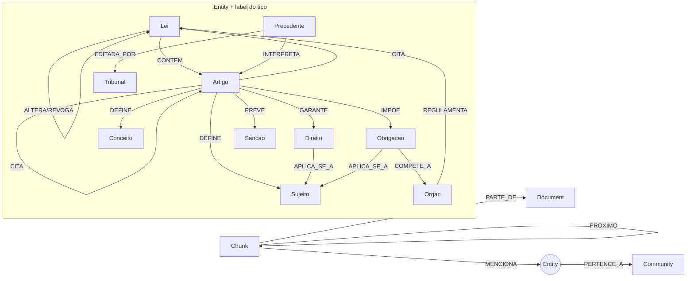

# Modelo LPG

O grafo tem duas camadas ligadas entre si:

- **Lexical:** documentos e trechos (chunks), de onde vem o texto citável.
- **Semântica:** entidades jurídicas e relações tipadas extraídas desses trechos.

A ligação `(:Chunk)-[:MENCIONA]->(:Entity)` faz a indexação mútua. Do fato se chega ao texto de origem, e do texto se chega aos fatos.



A lista completa de padrões aceitos (origem, relação, destino) está em `src/jurigraph/schema/model.py`. A extração descarta qualquer tripla fora dela.

## Rótulos e propriedades

| Rótulo | Propriedades | Observação |
|---|---|---|
| `Document` | `id`, `titulo`, `tipo` (lei, decreto, tese), `numero`, `ano`, `fonte`, `url`, `hash` | Um arquivo de `data/raw` |
| `Chunk` | `id`, `texto`, `ordem`, `rotulo` (ex.: "Art. 7º"), `embedding` | Corte por artigo; `id` é hash estável do documento e da posição |
| `Entity` + tipo | `key` (chave canônica), `nome`, `descricao`, `aliases`, `embedding`, `pagerank`, `comunidade` | Todo nó de entidade leva `:Entity` e um rótulo do domínio |
| `Lei` | `numero`, `ano` | `key` = `lei:13709` |
| `Artigo` | `numero`, `lei` | `key` = `artigo:13709:7` |
| `Precedente` | `tipo` (sumula, tese), `numero`, `tribunal` | `key` = `precedente:stf:987` |
| `Tribunal`, `Orgao`, `Conceito`, `Sujeito`, `Direito`, `Obrigacao`, `Sancao` | herdadas de `Entity` | `key` = `tipo:nome-normalizado` |
| `Community` | `id`, `nivel`, `resumo`, `tamanho`, `embedding` | Gerada pelo Leiden; o resumo é feito pelo LLM |

Relações semânticas carregam:

- `id`: hash estável de origem, tipo e destino, usado nas citações `[r:...]`.
- `fontes`: lista de ids dos chunks de onde a relação saiu. É o caminho do fato até o texto.
- `camada`: `estrutural` (regras) ou `semantica` (LLM).
- `confianca`: 1.0 nas regras e 0.8 no LLM.
- `evidencia`: trecho literal curto.

## Restrições e índices

| Nome | Tipo | Alvo | Por quê |
|---|---|---|---|
| `document_id`, `chunk_id`, `entity_key`, `community_id` | Unicidade | `id` / `key` | Garantem o `MERGE` idempotente e impedem nós duplicados; a unicidade em `Entity.key` é a base da resolução de entidades |
| `document_tipo`, `document_ano` | Range | `Document` | Filtros por tipo de norma e por ano |
| `lei_numero`, `artigo_numero`, `precedente_numero` | Range | Entidades | Buscas exatas que o Text-to-Cypher gera ("art. 7º da Lei 13.709") |
| `entity_nome` | Range | `Entity.nome` | Correspondência exata na resolução de entidades |
| `entity_pagerank`, `entity_comunidade` | Range | `Entity` | Ordenar o contexto por PageRank e filtrar por comunidade |
| `menciona_confianca` | Range (relação) | `MENCIONA.confianca` | Filtrar menções fracas |
| `entity_text` | Fulltext (`brazilian`) | `Entity.nome`, `Entity.descricao` | Achar a entidade pelo nome com stemming em português |
| `chunk_text` | Fulltext (`brazilian`) | `Chunk.texto` | Perna lexical (BM25) da busca híbrida |
| `chunk_embedding`, `entity_embedding`, `community_embedding` | Vetorial, 384 dims, cosseno | `embedding` | Perna semântica; a dimensão vem de `EMBEDDING_DIMENSIONS`, igual à do modelo |

A edição Community não oferece restrições de existência (`IS NOT NULL`) nem de chave de nó. Por isso, a presença de `key` e `id` é garantida no código de ingestão.

## Como recriar e verificar

```bash
.venv/bin/jurigraph-setup        # cria tudo com IF NOT EXISTS
.venv/bin/pytest tests/test_schema.py
```
